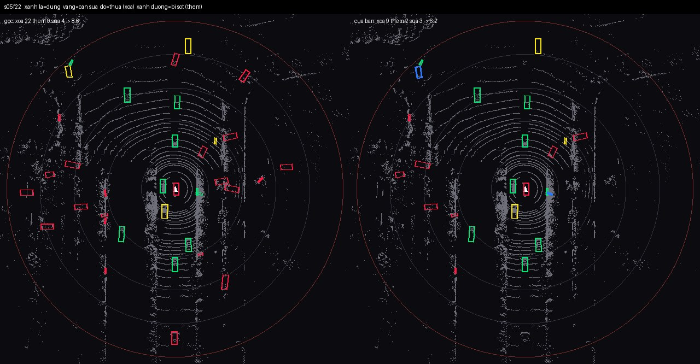

# Báo cáo Day 14 — Huynh Ngoc Gia Han — 2A202603128

- Mã học viên dùng với `--student`: `128`
- `seed_tag` trong `frames_A.txt`: `393590736f`
- Tập A: `s01f59`, `s04f03`, `s05f22`
- Tập B: `s02f18`, `s02f34`, `s02f55`, `s03f07`, `s03f34`, `s03f51`, `s04f17`, `s04f32`, `s04f50`, `s05f15`, `s05f32`, `s05f48`

## 1. Dự đoán trước sweep (bước 5b)

Ghi **trước** khi chạy `scripts/pp_sweep.py`, rồi commit và push ngay (lịch sử commit là bằng chứng thời điểm viết). Không sửa phần này sau khi có kết quả.

- Tham số tôi nghĩ giảm công sửa nhiều nhất: Tôi nghĩ nên tăng tham số score_thr so với mức mặc định
- Vì sao (nhìn ảnh BEV tập A: box thừa nhiều hay box sót nhiều?): Box thừa quá nhiều, đặc biệt là tool model đánh sai cây thành cyclist và đánh thừa car khá nhiều. Tăng ngưỡng sẽ giúp tránh thừa box, đỡ thao tác xoá box.

## 2. Tập A: sửa tay và tune

Nhãn tham chiếu `ref_A.json`: 51 box (s01f59: 21, s04f03: 16, s05f22: 14). Cấu hình gốc dự đoán 102 box, khớp 50.

| Cấu hình           | Xóa | Thêm | Sửa | Chi phí |
| -------------------- | ---: | ----: | ---: | -------: |
| Gốc                 |   52 |     1 |   13 |     23.1 |
| `best_config.json` |   21 |     7 |   11 |     18.8 |

Chi tiết cấu hình gốc theo frame:

| Frame  | Xóa | Thêm | Sửa | Chi phí |
| ------ | ---: | ----: | ---: | -------: |
| s01f59 |   22 |     1 |    5 |     10.1 |
| s04f03 |    8 |     0 |    4 |      4.4 |
| s05f22 |   22 |     0 |    4 |      8.6 |

- Tham số đã đổi trong `best_config.json`: `score_thr: 0.1 -> 0.4` (giữ `min_points = 0`; với `score_thr = 0.4`, ba mức `min_points` 0/5/10 cho cùng chi phí 18.8).
- Kết quả leave-one-out (dán các dòng `scripts/pp_sweep.py` in ra):

  ```
  s01f59: cấu hình chọn {'score_thr': '0.4', 'min_points': '0'} → 9.7 (tốt nhất có thể 9.2)
  s04f03: cấu hình chọn {'score_thr': '0.4', 'min_points': '0'} → 2.9 (tốt nhất có thể 2.9)
  s05f22: cấu hình chọn {'score_thr': '0.4', 'min_points': '0'} → 6.2 (tốt nhất có thể 6.2)
  ```

- Cấu hình có ổn định trên từng frame không? Vì sao tôi vẫn chọn (hoặc không chọn) nó: Khá ổn định. Cả 3 lượt leave-one-out đều chọn cùng một cấu hình `score_thr = 0.4`. Với s04f03 và s05f22, cấu hình này cũng là tốt nhất của chính frame đó (2.9 và 6.2). Riêng s01f59 thì `score_thr = 0.2` tốt hơn một chút (9.2 so với 9.7), nên cấu hình chưa tối ưu cho mọi frame. Tôi vẫn chọn 0.4 vì đây là mức có tổng chi phí thấp nhất (18.8) và frame không chọn được nó chỉ chênh 0.5. Có một điểm rủi ro: khi tăng lên 0.5, số box phải thêm nhảy từ 7 lên 14 và tổng chi phí tăng lên 22.6. Như vậy 0.4 nằm khá sát mức mà model bắt đầu bỏ sót nhiều. Còn `min_points` (0/5/10) không ảnh hưởng gì ở mức 0.4.

## 3. Trước/sau (bước 8)



| Frame | Chi phí gốc | `best_config.json` |
|---|---:|---:|
| s01f59 | 10.1 | 9.7 |
| s04f03 | 4.4 | 2.9 |
| s05f22 | 8.6 | 6.2 |
| **Tổng** | **23.1** | **18.8** |

- `scripts/pp_compare.py` báo giảm 19% công sửa trên tập A (23.1 → 18.8).
- Dự đoán ở mục 1 đúng hay sai? Giải thích bằng số box xóa/thêm/sửa: Đúng về hướng. Tăng `score_thr` từ 0.1 lên 0.4 giảm số box phải xóa từ 52 xuống 21 (bớt 31 box). Đổi lại, số box phải thêm tăng từ 1 lên 7 vì model bỏ sót một số vật thể có điểm tin cậy thấp. Số box phải sửa giảm nhẹ, từ 13 xuống 11. Phần giảm nhiều nhất là thao tác xóa, đúng như tôi dự đoán: lỗi chính của cấu hình gốc là box thừa. Tuy vậy, chi phí chỉ giảm 19%, không giảm nhiều như số box xóa. Lý do là 21 box thừa vẫn còn, trong khi việc thêm box bị sót tốn công hơn việc xóa (trọng số: xóa 0.3, thêm 1.0, sửa 0.5; 6 box thêm mới cộng 6.0 vào chi phí, còn 31 box bớt xóa chỉ trừ được 9.3).

## 4. Tập B

Số đo từ `scripts/pp_prelabel.py --frames d14_128/frames_B.txt --config d14_128/best_config.json --gt d14_128/ref_B.json`:

| Xóa | Thêm | Sửa | Chi phí |
| ---: | ----: | ---: | -------: |
|   89 |     8 |   24 |     46.7 |

Nhãn `ref_B.json`: 137 box trên 12 frame. Cấu hình `best_config.json` dự đoán 218 box, khớp 129.

| Frame | Xóa | Thêm | Sửa | Chi phí |
|---|---:|---:|---:|---:|
| s02f18 | 6 | 1 | 2 | 3.8 |
| s02f34 | 9 | 0 | 2 | 3.7 |
| s02f55 | 13 | 0 | 0 | 3.9 |
| s03f07 | 6 | 0 | 4 | 3.8 |
| s03f34 | 10 | 4 | 1 | 7.5 |
| s03f51 | 15 | 1 | 1 | 6.0 |
| s04f17 | 3 | 1 | 0 | 1.9 |
| s04f32 | 2 | 0 | 3 | 2.1 |
| s04f50 | 1 | 0 | 4 | 2.3 |
| s05f15 | 8 | 1 | 5 | 5.9 |
| s05f32 | 9 | 0 | 1 | 3.2 |
| s05f48 | 7 | 0 | 1 | 2.6 |

- Loại box tốn công sửa nhất ở tập B: box thừa cần xóa (89 × 0.3 = 26.7, khoảng 57% chi phí), sau đó là box cần sửa (24 × 0.5 = 12.0) và box bị sót cần thêm (8 × 1.0 = 8.0). Frame tốn nhất là s03f34 (7.5), chủ yếu vì phải thêm 4 box bị sót.

## 5. Giới hạn

- Tôi chỉ tune trên 3 frame (51 box tham chiếu). Mức giảm 19% đo trên chính các frame dùng để chọn cấu hình nên có thể lạc quan hơn thực tế. Leave-one-out với 3 frame chỉ kiểm tra được một phần. Kết quả trên tập B mới là con số đáng tin hơn.
- Model PointPillars được huấn luyện trên KITTI (cảm biến, góc đặt và lớp vật thể khác dữ liệu VF). Model nhầm cây thành cyclist, và tăng `score_thr` chỉ che bớt lỗi đó chứ không sửa được. Ở các cảnh khác, lỗi có thể xuất hiện theo kiểu khác.
- "Chi phí" là đơn vị có trọng số do script quy ước, không phải số giờ công thực tế. Tôi chỉ quét 2 tham số (`score_thr`, `min_points`) và chưa thử ngưỡng riêng cho từng lớp (`thr_car`, `thr_cyc`, `thr_ped`). Nhãn `ref_A.json` cũng do chính tôi sửa nên có thể chưa thật chính xác.
